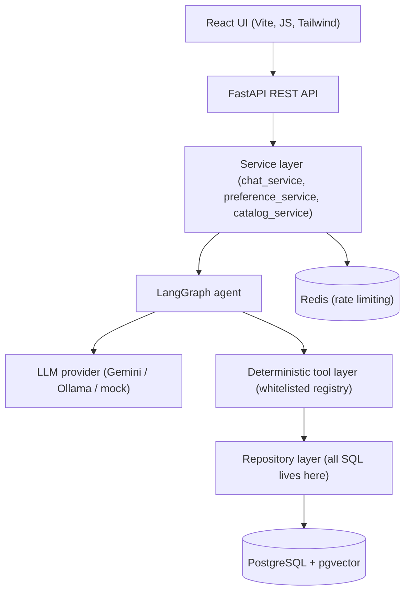
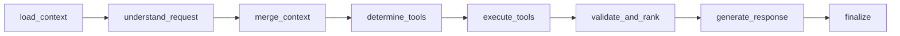
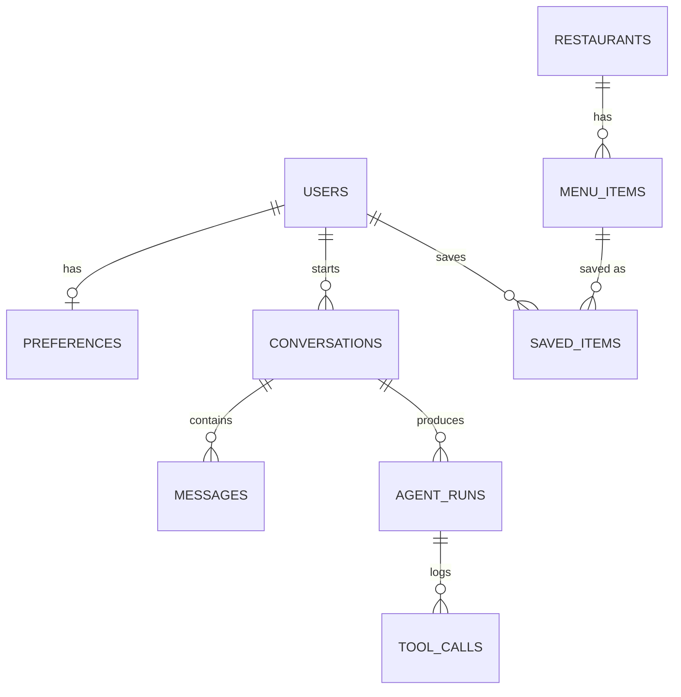

# AI Food Concierge

An agentic, conversational food-discovery application built as a portfolio
project for AI-focused backend/SDE roles. It demonstrates a genuinely
engineered LangGraph agent — typed state, explicit multi-step workflow,
strict tool contracts, deterministic ranking, structured observability,
and real (non-fabricated) tests and evaluation — rather than a thin LLM
chatbot wrapper.

> **Demo data — not live availability.** All restaurant and menu data is
> synthetic, created for this project. Nothing is scraped, reverse
> engineered, or sourced from Swiggy, Zomato, or any live delivery
> platform, and this project has no affiliation with any of them.

---

## 1. Problem statement

Food-delivery apps are good at listing everything; they're bad at
*understanding* an open-ended request like "something light for dinner,
vegetarian, nothing too heavy." This project explores what it takes to
build an agent that can:

- turn a loosely-specified natural-language request into structured
  constraints,
- decide which backend capability (tool) is needed to satisfy it,
- combine hard filters (budget, diet) with soft semantic relevance
  ("light", "comforting") without ever letting the soft signal override a
  hard constraint,
- remember what was just shown well enough to resolve "compare the first
  and third," and
- distinguish a one-off request from a durable preference worth
  remembering — without an LLM ever touching the database directly.

## 2. Features

- Conversational search with hybrid SQL + semantic retrieval
- Deterministic, explainable ranking with configurable weights
- Ordinal reference resolution ("compare the first and third")
- Short-term memory (constraint carry-over across turns) and long-term
  memory (explicit/high-confidence preferences only)
- Save/compare menu items
- Full audit trail of every agent run and tool call
- Runs end-to-end with **zero external API keys** (mock LLM provider) or
  with a real Gemini/Ollama model behind one config flag

## 3. Architecture



The LLM never has direct database access. It proposes an intent and
structured constraints; everything downstream — filtering, ranking,
persistence — is deterministic, validated, parameterized code:

```
LLM proposes intent/constraints
        ↓
strict Pydantic validation
        ↓
whitelisted deterministic tool
        ↓
repository layer (parameterized SQL only)
        ↓
PostgreSQL / pgvector
        ↓
validated, ranked result
        ↓
template-based response generation
```

## 4. Agent workflow

Implemented with LangGraph (`backend/agents/graph.py`) as an explicit
8-node graph, not "user → LLM → response":



- **load_context** — pulls recent conversation history + last shown items
- **understand_request** — the *only* node that calls the LLM; returns
  intent + structured constraints, validated against a fixed enum/schema
- **merge_context** — short-term memory: constraints the current message
  didn't mention are inherited from the most recent search in this
  conversation (e.g. "make it spicy" keeps the earlier budget/diet filter)
- **determine_tools** — maps intent → tool(s) via a fixed lookup, not LLM
  judgment
- **execute_tools** — runs tools through the whitelisted registry
- **validate_and_rank** — the ranking already happened deterministically
  inside `search_food`; this validates shape before use
- **generate_response** — deterministic, template-based reply grounded in
  the ranked items (kept separate from ranking itself — see trade-offs)
- **finalize** — marks the run complete; the service layer persists the
  `AgentRun`/`ToolCall` audit rows around the whole invocation

Agent activity surfaced to the UI is a fixed set of short, high-level
labels ("Executed tools", "Validated and ranked results") — never raw
chain-of-thought.

## 5. Tool architecture

Nine deterministic tools, each with a strict Pydantic input schema,
logging, timing, and error handling (`backend/tools/`):

`search_food`, `get_food_details`, `get_menu`, `compare_items`,
`get_user_preferences`, `save_preference`, `get_conversation_context`,
`save_item`, `remove_saved_item`.

All are looked up through a single whitelist (`backend/tools/registry.py`).
An LLM proposing an unknown tool name is rejected before anything runs —
verified by `test_unknown_tool_name_is_rejected`.

## 6. Database design



All PKs are UUIDs (portable `GUID` type: native `UUID` on Postgres,
`CHAR(32)` on SQLite so contributors can run tests without installing
Postgres). Foreign keys cascade on delete. Indexes on the columns actually
filtered on (`cuisine`, `price`+`is_vegetarian`, `cuisine`+`spice_level`,
etc. — see `backend/models/`). Migrations are managed by Alembic
(`backend/alembic/`); the initial migration was generated **and tested**
against a real local PostgreSQL 16 + pgvector instance (upgrade → verified
10 tables + `vector(384)` column → downgrade → re-upgrade, all clean).

## 7. Retrieval architecture

Two levels, combined, never in tension:

1. **Structured SQL filtering** (hard constraints) — price, dietary
   preference, spice level, cuisine, rating floor. These are never
   relaxed for the sake of semantic similarity.
2. **Semantic similarity** over the free-text remainder of the query
   ("something light for dinner"), computed only across items that
   already passed the SQL filters.

The semantic layer uses `HashingEmbeddingProvider`
(`backend/tools/embeddings.py`): a deterministic, offline bag-of-words
hashing embedding with a small documented synonym expansion (light →
salad/soup/steamed/…). This is a **stand-in** for a real embedding model —
swapping in Gemini's `text-embedding-004` (or any other provider) means
implementing the same `EmbeddingProvider` protocol; nothing else in the
retrieval pipeline changes. In production the same vectors are stored in
`pgvector` and would use an ANN index (ivfflat/hnsw) instead of the
in-Python cosine similarity used for the SQLite dev fallback.

## 8. Ranking

Deterministic, in `backend/tools/ranking.py`. The LLM never decides which
item ranks above another. Score is a configurable weighted sum of:
constraint match, semantic relevance, rating, price fit, cuisine match
(weights in `Settings.RANKING_WEIGHT_*`, changeable via env vars — verified
by `test_ranking_weights_configurable`, which asserts a weight change
actually shifts scores). `explain_reason()` generates the "why recommended"
text from the same signals, so the shown reason can never mismatch the
actual ranking. See §11 for the deterministic-vs-LLM-ranking trade-off.

## 9. Memory design

- **Short-term**: `merge_context` node inherits unset constraint fields
  from the most recent search in the conversation (backed by
  `AgentRunRepository.get_last_search_constraints`).
- **Long-term**: `should_persist_preference()`
  (`backend/agents/memory.py`) only allows `save_preference` to run when
  the NLU layer detected an explicit persistence signal ("I usually
  prefer…", not "I want spicy food right now"). Verified by
  `test_chat_one_off_preference_statement_is_not_persisted`.

## 10. Guardrails

- Every tool argument validated by a strict Pydantic schema before
  touching business logic (`backend/tools/base.py::validate_params`)
- Tool names checked against a fixed whitelist
  (`backend/tools/registry.py`)
- Coarse prompt-injection screening on raw user input
  (`backend/core/guardrails.py`) — logged, not silently rewritten; the
  agent always treats user text as untrusted data, never as an instruction
- No raw/arbitrary SQL anywhere outside the repository layer, and even
  there, everything is parameterized through SQLAlchemy
- Rate limiting per user (Redis-backed, in-memory fallback)

## 11. Error handling

Distinguishes transient vs. permanent failures (`LLMProviderError.retriable`,
`ToolError.retriable`). LLM timeouts/5xx are retried with exponential
backoff (`tenacity`); malformed LLM output degrades to a safe "unknown
intent" response rather than crashing (`test_agent_graph_malformed_llm_output_falls_back_gracefully`).
Tool exceptions are always converted to a structured `ToolResult`, never a
raw 500. Empty search results return a helpful message, not an error
(`test_chat_no_results_returns_helpful_message_not_error`).

## 12. Observability

Structured JSON logs (`backend/core/logging.py`) carry `request_id`,
`conversation_id`, and `agent_run_id` via `contextvars`, so a single user
turn can be traced: HTTP request → agent run → LLM call → tool call → DB
query → response. Every agent run and tool call is also persisted to the
database (`agent_runs`, `tool_calls` tables) as a durable audit trail, not
just transient logs.

## 13. Evaluation methodology

`backend/evaluation/run_eval.py` is a repeatable script (not a pytest
test) that runs a labeled 8-case conversation set against the live agent
graph and reports **measured** intent accuracy, invalid-tool-call rate,
and task completion rate — numbers come from actual execution, never
hardcoded. Last run against the mock LLM provider:

```json
{
  "total_cases": 8,
  "intent_accuracy": 1.0,
  "invalid_tool_call_rate": 0.0,
  "task_completion_rate": 1.0
}
```

Two real gaps were found and fixed while building this (not hidden):
the initial mock NLU classified "I prefer North Indian food usually" as
`search_food` (word-order-sensitive phrase matching), and "compare these
two" wasn't recognized without explicit ordinals. Both are fixed in
`backend/agents/mock_nlu.py`; a real LLM provider would not have needed
either fix — this is a limitation of the offline rule-based mock, not of
the agent architecture.

Run it yourself: `python -m backend.evaluation.run_eval`

## 14. Testing

46 tests, `backend/tests/`, all passing:

- **Unit** (`tests/unit/`) — ranking math, all 9 tools including rejection
  of invalid/negative/out-of-range arguments, guardrails, and NLU
  extraction (including a regression test for the history-bleed bug found
  during manual testing)
- **Integration** (`tests/integration/`) — full FastAPI → agent → tools →
  DB flows: search, multi-turn context carry-over, compare, preference
  persistence, 404s, empty results, rate-limit headers
- **Agent** (`tests/agent/`) — graph-level tests including a simulated
  malformed-LLM-response failure path and a determinism check (same
  request + same data ⇒ same ranking)

Run: `pytest backend/tests -q` (uses an isolated in-memory SQLite DB per
test, `LLM_PROVIDER=mock`, and a hand-built fixture catalog independent of
the demo dataset).

## 15. Technology choices

| Layer | Choice |
|---|---|
| Frontend | React (JavaScript, no TypeScript) + Vite + Tailwind v4 |
| Backend | FastAPI + Pydantic + SQLAlchemy + Alembic |
| Agent | LangGraph, LangChain-core |
| LLM | Gemini (primary), Ollama (local optional), mock (offline default) |
| DB | PostgreSQL + pgvector |
| Cache/rate-limit | Redis |
| Tests | pytest, pytest-asyncio |
| Infra | Docker, docker-compose |
| Lint/format/types | ruff, black, mypy (advisory) |
| CI | GitHub Actions |

## 16. Trade-offs

**FastAPI vs Spring Boot** — FastAPI was chosen for tight integration with
the Python LLM/agent ecosystem (LangGraph, LangChain) and Pydantic sharing
validation schemas across the API and tool layers. Spring Boot would be
the stronger choice if the team's other services are JVM-based, or if
compile-time typing across the whole stack matters more than
LLM-ecosystem integration.

**LangGraph vs a custom state machine** — LangGraph gives typed state,
built-in graph visualization/debugging, and a vocabulary (nodes/edges/
conditional routing) that's becoming a de facto standard, at the cost of
an extra dependency and a small learning curve. A hand-rolled state
machine would have less overhead for a workflow this size, but wouldn't
demonstrate familiarity with the tool the job spec asks for.

**PostgreSQL vs MongoDB** — the domain (restaurants → menu items,
conversations → messages, users → preferences) is naturally relational
with real foreign-key constraints worth enforcing; MongoDB would suit a
more schema-flexible or document-shaped domain better.

**pgvector vs a dedicated vector DB (Pinecone/Weaviate/etc.)** — pgvector
keeps structured filters and vector search in one transactional store and
one query, avoiding a second system to keep in sync, at the cost of scaling
less far than a purpose-built vector DB at very large corpus sizes. For a
demo-sized catalog this isn't a real constraint; at millions of items it
would be.

**Redis vs PostgreSQL-only** — Redis is used *only* for rate limiting
(§17), where per-process in-memory counting is wrong the moment there's
more than one backend instance. Everything else (conversation state,
preferences) is durable and belongs in Postgres, not a cache — this is
deliberate, not "Redis because the spec mentioned it."

**Gemini vs Ollama** — Gemini needs no local GPU/model management and is
what most reviewers can actually run; Ollama is included and fully
implemented (not stubbed) for anyone who wants a fully local, zero-API-cost
path. Both implement the same `LLMProvider` protocol as the mock, so
switching is one env var.

**Deterministic ranking vs LLM ranking** — see §8: ranking is intentionally
kept out of the LLM's hands for reproducibility and testability. The
trade-off is that ranking can't use nuanced language understanding the way
an LLM-scored re-rank could (e.g. subtly weighing "not too heavy" against
"filling" for a specific dish) — the semantic-similarity term is the
approximation for that, at coarser granularity than an LLM re-ranker would
give.

**SQL filtering vs semantic retrieval** — SQL filtering owns hard
constraints; semantic retrieval only re-orders what already passed. The
alternative (semantic-first, filter-after) risks losing correct
budget/dietary matches to a "more semantically relevant" but
out-of-budget or non-vegetarian item — considered and rejected for this
reason.

**LLM planning vs deterministic execution** — the LLM only ever proposes;
every tool call is validated and executed by deterministic code. This
costs some flexibility (the LLM can't invent a new capability on the fly)
in exchange for the system being auditable, testable, and safe against a
model that hallucinates a tool call.

**Short-term vs long-term memory** — short-term (per-conversation
constraint carry-over) is cheap and always safe to apply; long-term
(persisted preferences) is gated behind an explicit persistence signal
specifically because it's much more costly to get wrong (a wrongly
"remembered" preference silently biases every future recommendation).

## 17. Local setup

### Option A — Docker Compose (recommended)

```bash
cp backend/.env.example backend/.env   # edit if you want a real LLM provider
docker compose up --build
docker compose exec backend python -m backend.scripts.seed_data
```

- Frontend: http://localhost:8080
- Backend: http://localhost:8000 (docs at `/docs`)

### Option B — manual

```bash
# Backend
cd backend
python -m venv .venv && source .venv/bin/activate
pip install -r requirements.txt
cp .env.example .env
# point DATABASE_URL at a running Postgres, or leave the sqlite default for a quick spin
alembic upgrade head            # only needed against Postgres — sqlite dev mode auto-creates tables
python -m backend.scripts.seed_data
uvicorn backend.main:app --reload

# Frontend (separate terminal)
cd frontend
npm install
cp .env.example .env
npm run dev
```

## 18. Environment variables

See `backend/.env.example` and `frontend/.env.example` for the full,
commented list. Nothing is hardcoded; `LLM_PROVIDER=mock` (the default)
needs no credentials at all.

## 19. Dataset information

`backend/data/demo_dataset.json` — 6 fictional restaurants, 24 menu items,
fully synthetic, created for this project (see the file's own
`_dataset_notice`). Loaded via `backend/scripts/seed_data.py`, which
validates every record against a strict schema, de-duplicates by
restaurant and dish name, and is idempotent (safe to re-run). The running
application never depends on this file at request time — ingestion is a
one-time/CI-time step.

## 20. API documentation

Interactive OpenAPI docs at `/docs` once running. Summary:

| Method | Path | Purpose |
|---|---|---|
| POST | `/api/chat` | Send a message, get a reply + ranked recommendations |
| GET | `/api/conversations/{id}` | Full message history for a conversation |
| GET | `/api/preferences?user_id=` | Read long-term preferences |
| PUT | `/api/preferences?user_id=` | Directly update preferences |
| GET | `/api/food/{id}` | Menu item detail |
| POST | `/api/compare` | Compare 2–5 menu items by id |
| POST | `/api/saved-items` | Save a menu item |
| GET | `/api/saved-items?user_id=` | List saved items |
| DELETE | `/api/saved-items/{id}` | Remove a saved item |
| GET | `/health` | Liveness check |

## 21. Screenshots / demo instructions

No headless browser was available in the build environment to capture
screenshots, so the UI has been verified by build/lint (`npm run build`,
`npm run lint`) rather than a visual screenshot — take one after `npm run
dev` locally. To reproduce the documented demo conversation:

1. "I want spicy vegetarian food under 400, preferably paneer."
2. "Which one is lighter?"
3. "Compare the first and third."
4. "I usually prefer spicy North Indian food."

All four turns were verified end-to-end against a running instance
(curl), including checking that the preference from turn 4 is actually
persisted and returned by `GET /api/preferences` afterward.

## 22. Known limitations

- The offline `HashingEmbeddingProvider` is a documented approximation of
  a real embedding model — good enough for the demo dataset's vocabulary,
  not a claim of state-of-the-art semantic understanding.
- The mock NLU (`agents/mock_nlu.py`) is regex/keyword-based and won't
  handle arbitrary phrasing as well as a real LLM — two real gaps found
  during evaluation are documented and fixed in §13, but this remains a
  simpler substitute than Gemini/Ollama, by design (so the project runs
  with zero API keys).
- `mypy` is wired into CI as advisory (non-blocking): TypedDict strictness
  around the agent state and Pydantic-model-vs-dict boundaries surfaces
  several real type errors that would need either loosening the TypedDict
  or adding conversion layers at each tool boundary — a deliberate scope
  cut, not an oversight.
- Alembic's autogenerate does not import custom `TypeDecorator` classes
  (`GUID`, `EmbeddingVector`) automatically; the generated migration
  needed a manual import added — documented in the migration file itself.
- No authentication layer — `user_id` is a client-generated UUID stored in
  `localStorage`. Fine for a portfolio demo, not for a real deployment.
- Generated response text is template-based, not LLM-authored, to keep
  the agent graph's language layer fully swappable and to guarantee the
  reply never contradicts the deterministic ranking it's describing —
  documented trade-off, see §16.

## 23. Future improvements

- Swap `HashingEmbeddingProvider` for a real embedding model behind the
  same interface
- LLM-authored (but ranking-grounded) response generation as an optional
  mode
- Streaming responses over SSE/websockets
- Auth + multi-device account linking instead of a localStorage user id
- A second Alembic migration exercising an actual schema change, to
  demonstrate the upgrade/downgrade path beyond the initial migration

## 24. How to explain this project in an interview

- **What problem does it solve?** Turning open-ended food requests into
  grounded recommendations without an LLM ever deciding what's "correct"
  — ranking, filtering, and persistence are all deterministic and
  testable; the LLM's job is narrowly scoped to language understanding.
- **What's the hardest part?** Keeping the LLM's role bounded: every tool
  call is validated against a strict schema and a whitelist before it can
  touch anything, and hard constraints (budget, diet) are structurally
  incapable of being overridden by semantic similarity.
- **What would you change with more time?** Swap the mock NLU/embeddings
  for real models (the interfaces are already there), add auth, and
  tighten the mypy/TypedDict boundary properly instead of leaving it
  advisory.
- **What did you actually verify, not just write?** The full documented
  demo conversation was run against a live server via curl (not just unit
  tests) — including finding and fixing two real bugs during that manual
  pass. The Alembic migration was generated and round-tripped
  (upgrade/downgrade/upgrade) against a real local PostgreSQL 16 +
  pgvector instance, not just SQLite. All 46 tests and the evaluation
  script were actually executed, and their real output is what's quoted
  in this README.

## 25. Project structure

```
ai-food-concierge/
├── backend/
│   ├── api/routes/        # thin controllers
│   ├── services/          # orchestration (chat, preferences, catalog)
│   ├── agents/            # LangGraph state, nodes, graph, LLM providers
│   ├── tools/              # deterministic tools + ranking + embeddings
│   ├── models/             # SQLAlchemy models
│   ├── schemas/            # Pydantic request/response/tool schemas
│   ├── repositories/       # all SQL lives here
│   ├── database/           # session, portable UUID/vector types
│   ├── core/                # config, logging, guardrails, rate limiting
│   ├── evaluation/          # repeatable agent eval script
│   ├── scripts/              # seed/ingestion
│   ├── data/                  # synthetic demo dataset
│   ├── alembic/                 # migrations
│   └── tests/{unit,integration,agent}/
├── frontend/
│   └── src/{components,context,api}/
├── docker-compose.yml
└── .github/workflows/ci.yml
```
